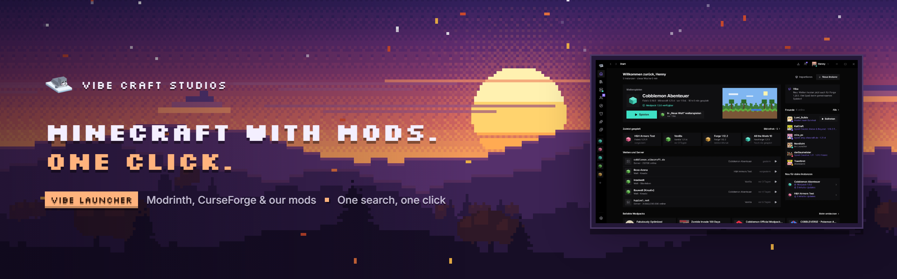
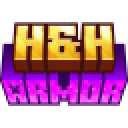
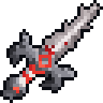
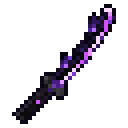

  

  <a href="https://vibec-studios.github.io/"><b>Website</b></a>
  &nbsp;·&nbsp;
  <a href="https://vibec-studios.github.io/downloads/"><b>Downloads</b></a>
  &nbsp;·&nbsp;
  <a href="https://vibec-studios.github.io/status/"><b>Vibey status</b></a>

A small studio for Minecraft mods. We build boss fights with a story, worlds of their own and gear you have to earn,
plus tools that make playing together easier. Every model, animation and effect is our own, and every download comes
with a checksum and a VirusTotal scan.

## Projects

### HHA series

<table width="100%">
  <tr>
    <td width="76" align="center"></td>
    <td>
      <b><a href="https://github.com/vibec-studios/HHA">H&amp;H Armors</a></b> · core mod · <i>released</i> 
      Two rival endgame armor sets, Heaven and Hell. Climb Olympus to Zeus, descend into Tartarus to Hades and Kronos:
      twelve boss fights on the way. 
      <a href="https://vibec-studios.github.io/mods/hha/">Website</a> · <a href="https://vibec-studios.github.io/downloads/#hha">Download</a> · Fabric · Minecraft 1.21.11
    </td>
  </tr>
  <tr>
    <td width="76" align="center"></td>
    <td>
      <b><a href="https://github.com/vibec-studios/hha-blood">HHA Blood</a></b> · addon · <i>in development</i> 
      Blood’s Armor with real bleeding, the Vein Hollows below the Nether and a fight against Cerberus and the Minotaur. 
      <a href="https://vibec-studios.github.io/mods/blood/">Website</a> · Fabric · Minecraft 1.21.11
    </td>
  </tr>
  <tr>
    <td width="76" align="center"></td>
    <td>
      <b><a href="https://github.com/vibec-studios/HHA_void">HHA Void</a></b> · addon · <i>in development</i> 
      Void’s Armor with teleports, meteors and a black hole, and Oruun, a leviathan made of stars. 
      <a href="https://vibec-studios.github.io/mods/void/">Website</a> · Fabric · Minecraft 1.21.11
    </td>
  </tr>
  <tr>
    <td width="76" align="center"></td>
    <td>
      <b><a href="https://github.com/vibec-studios/hha-arius">HHA Arius</a></b> · addon · <i>released</i> 
      The White Blade: a duel against Arius and Solvane, the white dragon his sword once was, and the Dragonheart Watch armour. 
      <a href="https://vibec-studios.github.io/mods/arius/">Website</a> · <a href="https://vibec-studios.github.io/downloads/#arius">Download</a> · Fabric · Minecraft 1.21.11
    </td>
  </tr>
</table>

### Standalone

<table width="100%">
  <tr>
    <td width="76" align="center"></td>
    <td>
      <b><a href="https://github.com/vibec-studios/vibey-multiplayer">Vibey Multiplayer</a></b> · mod · <i>released</i> 
      Host your singleplayer world for friends from anywhere. One fixed address, no port forwarding, no server. 
      <a href="https://vibec-studios.github.io/mods/vibey/">Website</a> · <a href="https://vibec-studios.github.io/downloads/#vibey">Download</a> · <a href="https://vibec-studios.github.io/status/">Relay status</a> · Fabric &amp; NeoForge · Minecraft 1.21 – 26.3
    </td>
  </tr>
</table>

## How we build

- **Fair, not frustrating.** Every attack is announced, every boss has a trick, and losing never costs your inventory.
- **Handmade.** Our own models, animations and effects; worlds are built from vanilla blocks so everything still feels
  like Minecraft.
- **Two languages.** Everything ships in German and English.
- **Checked downloads.** Files come straight from GitHub releases, with SHA-256 and a VirusTotal report for each one.

Found a bug or have an idea? Open an issue in the project’s repository. German is fine too.

Not an official Minecraft product. Not approved by or associated with Mojang or Microsoft.
